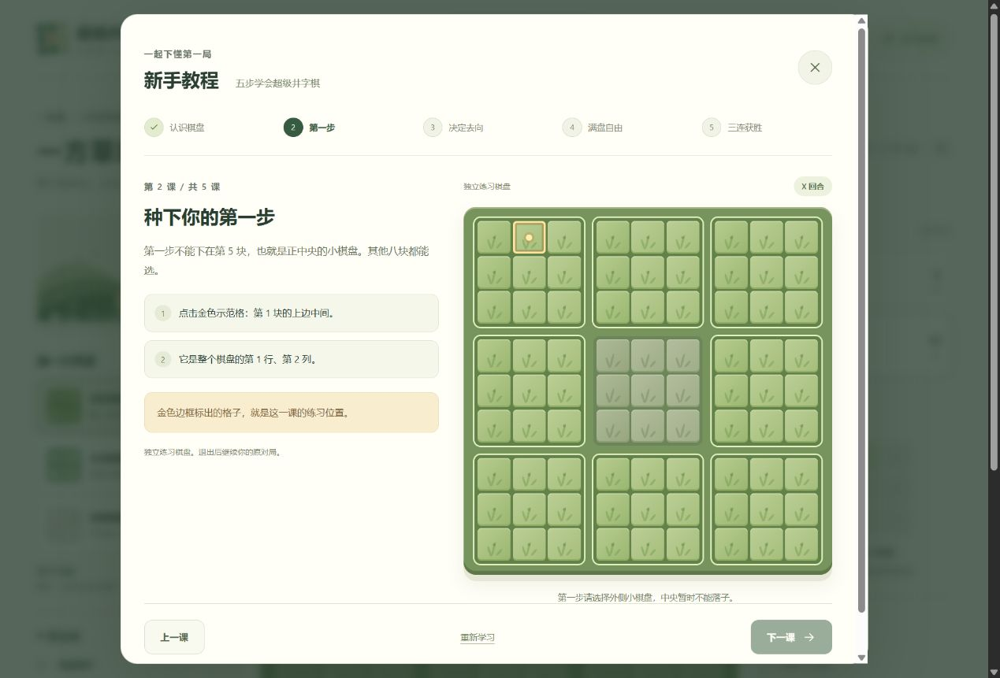

# 超级井字棋 · 田园版

[在线试玩](https://zohar625.github.io/super-tic-tac-toe/)

在九块小棋盘间步步为营。本地双人或输入六位房间码与朋友联机，无需注册。


## 游戏规则

1. 整体是 9×9 棋盘，分为九块 3×3 小棋盘。X 先手，双方轮流落子。
2. 第一手不能落在中央的小棋盘。
3. 你在小棋盘内选择的位置，决定对手下一步必须去哪个小棋盘。例如选右上角，对手下一步去右上角的小棋盘。
4. 目标小棋盘已经下满时，对手可以自由选择任何还有空格的小棋盘，中央也可以。
5. **整个 9×9 棋盘中，任意三个连续的同方棋子横、竖、斜连线即获胜，可以跨小棋盘边界。** 不计算小棋盘胜负。
6. 全盘填满且无人获胜时平局。

## 新手教程与皮肤

顶部“新手教程”提供五步互动练习：认识棋盘、首步禁中央、决定对手去向、满盘自由选择、跨盘三连。金色示范格引导落子，点错会提示；支持上一课、重学及 Esc 退出，原对局保留。



经典、草地、稻田三套皮肤可即时切换。X 翻土，O 长出新芽，胜利时出现连线和短暂粒子效果。皮肤和动画开关保存在本机，遵守系统减弱动态设置。

## 好友联机

点击“好友对战”→ 创建房间 → 把六位数字告诉朋友 → 对方输入房间码加入。

使用 [EMQX 公共 MQTT WebSocket 中转](https://www.emqx.com/en/mqtt/public-mqtt5-broker)，无需数据库、云账号或自建服务器。房主负责校验棋步；双方确认再来一局后交换先后手。连接中断时暂停落子并尝试恢复。

房主需要保持页面打开，关闭或刷新会结束房间。免费公共服务可能暂时不可用，部分网络可能屏蔽 WebSocket 端口。六位房间码用于朋友间找房，不是私密认证；不适用于敏感信息、公开比赛或防作弊场景。只传棋步、心跳与临时随机标识，不传姓名和账号。

## 本地开发

使用 Node.js 24 或更高版本：

```sh
npm ci
npm run dev
```

无需 `.env` 或 Supabase 密钥。

## 验证与部署

```sh
npm test
npm run lint
npm run build
```

16 项行为测试覆盖对局规则、房间协议、断线恢复和互动教程。需要测试真实中转时，在 `npm test` 后运行 `node scripts/live-network.mjs`。

推送到 `master` 后，GitHub Actions 验证、构建并发布到 `gh-pages`，更新在线试玩网址。构建路径为 `/super-tic-tac-toe/`。
